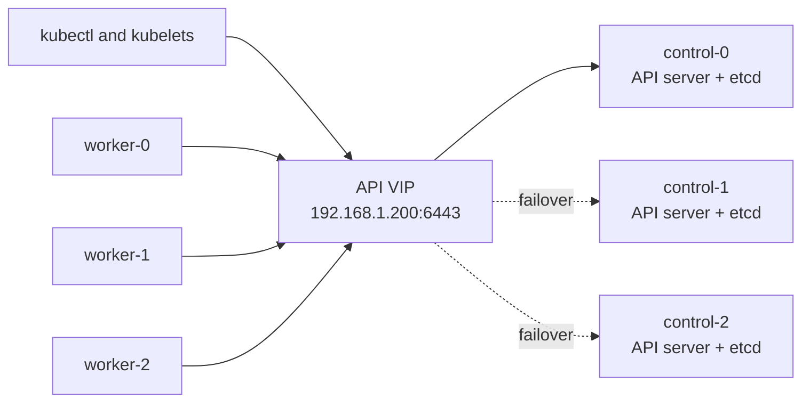

# Kubernetes Bootstrap with Ansible

This directory bootstraps the virtual machines created by Terraform into a
high-availability Kubernetes cluster. The control plane uses stacked etcd and
kube-vip provides a shared API endpoint on the local Layer 2 network.


## Resulting topology



Only one control-plane node owns the IPv4 VIP at a time. kube-vip elects the
owner and advertises the address with ARP. All API clients use the VIP rather
than a specific control-plane address.

The checked-in defaults are:

| Purpose | Value | Source |
| --- | --- | --- |
| Kubernetes version | `1.30.14` | `group_vars/all.yml` |
| API virtual IP | `192.168.1.200/32` | `group_vars/all.yml` |
| kube-vip interface | `eth0` | `group_vars/all.yml` |
| Pod networks | `10.255.0.0/16`, `fd00:10:255::/56` | kubeadm template |
| Service networks | `10.36.0.0/16`, `fd00:10:36::/108` | kubeadm template |
| Container runtime | containerd with systemd cgroups | `k8s_prep` role |
| Kubernetes API port | TCP `6443` | kubeadm and kube-vip |

The Pod and Service networks make this a dual-stack cluster configuration.
The node network, CNI, routers, and firewalls must support both address
families. If the environment is IPv4-only, change both subnet values to a
single IPv4 CIDR before the first `kubeadm init`.

## What each role does

### `k8s_prep`

This role runs on every node. It:

- disables swap now and comments swap entries in `/etc/fstab`;
- loads `overlay` and `br_netfilter` and persists them across reboots;
- enables bridge netfilter, IPv4 forwarding, and IPv6 forwarding;
- installs containerd and writes its generated default configuration;
- enables containerd's `SystemdCgroup` setting;
- aligns containerd's sandbox image with the configured Kubernetes pause image;
- configures the Kubernetes package repository for the selected minor release;
- installs exact versions of `kubelet`, `kubeadm`, and `kubectl`; and
- places those packages on hold to prevent accidental upgrades.

The role targets Debian or Ubuntu systems because it uses APT and Debian package
version syntax.

### `kube_vip`

This role runs only on control-plane nodes. It renders kube-vip as a static Pod
in `/etc/kubernetes/manifests`. The manifest:

- uses ARP to advertise the API VIP;
- participates in leader election;
- uses host networking and the configured host interface; and
- initially mounts `/etc/kubernetes/super-admin.conf`, which is needed during
  kubeadm bootstrap on Kubernetes 1.29 and later.

The configured VIP must be unused, outside the DHCP pool, and reachable on the
same Layer 2 network as every control-plane node. The configured interface name
must exist on every control-plane node.

### `k8s_init`

This role initializes and expands the control plane. It:

- writes inventory hostnames into `/etc/hosts`;
- renders `/tmp/kubeadm-config.yaml` on the first control-plane node;
- runs `kubeadm init --upload-certs` only on that first node;
- creates a fresh join command and uploads the shared certificates;
- joins the remaining nodes as control-plane members; and
- installs `/home/<ansible_user>/.kube/config` on each initialized control-plane
  node.

The first member of the `control_nodes` inventory group is always the bootstrap
node. Changing inventory order after a partial deployment can therefore change
which host Ansible treats as the source of join credentials.

### `post_processing`

After initialization, this role changes the kube-vip volume from
`super-admin.conf` to the less privileged `admin.conf`. Updating the static Pod
manifest makes kubelet recreate kube-vip with the normal administrator
kubeconfig.

### `join_worker_nodes`

This role delegates to the first control-plane node to create a fresh kubeadm
join command, then runs it on every worker. The presence of
`/etc/kubernetes/kubelet.conf` prevents an already joined worker from joining
again.

## Prerequisites

### Ansible controller

Install the following on the machine from which the playbooks will run:

- Ansible Core;
- the `community.general` collection, used for `modprobe`;
- an SSH client and the private key `~/.ssh/tf_rsa`; and
- `kubectl` if the cluster will be managed from this machine.

Install the required collection with:

```bash
ansible-galaxy collection install community.general
```

### Cluster nodes

Every VM must have:

- a unique hostname and static IPv4 address;
- at least 2 CPU cores and roughly 2 GiB of memory for a control-plane node;
- outbound access to `pkgs.k8s.io`, `registry.k8s.io`, and `ghcr.io`;
- working DNS and synchronized time;
- passwordless sudo for the Ansible user; and
- network reachability among all nodes.

At minimum, allow the following traffic within the cluster network:

| Port | Protocol | Used by |
| --- | --- | --- |
| `6443` | TCP | Kubernetes API server |
| `2379-2380` | TCP | stacked etcd between control-plane nodes |
| `10250` | TCP | kubelet API on every node |
| `10257` | TCP | kube-controller-manager |
| `10259` | TCP | kube-scheduler |

The CNI may require more ports or protocols. NodePort Services also require TCP
and UDP `30000-32767` when they are used.

## Configure the deployment

### 1. Create the SSH key

Terraform reads the public key from `~/.ssh/tf_rsa.pub`, and the generated
Ansible inventory uses the matching private key.

```bash
ssh-keygen -t rsa -b 4096 -f ~/.ssh/tf_rsa -N ""
```

Skip this command if that key already exists. Never overwrite a key that is
still needed for existing machines.

### 2. Configure Terraform VM addresses and names

Copy the example variable file from the repository root:

```bash
cp terraform.tfvars.example terraform.tfvars
```

Use static CIDR addresses and gateways in the `vms` map. VM keys must contain
`control` or `worker` so `outputs.tf` puts them in the correct inventory group.
For example:

```hcl
vms = {
  "control-0" = {
    n_name = "pve1"
    id     = 110
    cpu    = 2
    memory = 4096
    ip4    = "192.168.1.170/24"
    gw4    = "192.168.1.1"
  }

  "worker-0" = {
    n_name = "pve1"
    id     = 120
    cpu    = 4
    memory = 8192
    ip4    = "192.168.1.160/24"
    gw4    = "192.168.1.1"
  }
}
```

Add a routable IPv6 address and gateway to every VM when using the checked-in
dual-stack Kubernetes subnets.

### 3. Review Kubernetes and kube-vip variables

Edit `group_vars/all.yml` before initializing the cluster:

```yaml
kubernetes_version: "1.30.14"
kubernetes_pause_image: "registry.k8s.io/pause:3.9"

kube_vip_address: "192.168.1.200"
kube_vip_interface: "eth0"
kube_vip_subnet: "32"
kube_vip_version: "v1.2.0-rc.0"
```

Confirm the interface name on every control-plane VM. Cloud images often use
names such as `ens18`, not `eth0`:

```bash
ansible -i ansible/inventory.ini control_nodes \
  -m command -a "ip -brief link"
```

Do not select a VIP already assigned to another host or included in a DHCP
allocation range.

Changing only `kubernetes_version` is not a complete upgrade. This repository
uses kubeadm API `v1beta3` and exact Debian package versions. Review the
[kubeadm configuration API](https://kubernetes.io/docs/reference/config-api/kubeadm-config.v1beta4/)
and the [Kubernetes version-skew policy](https://kubernetes.io/releases/version-skew-policy/)
before choosing a newer release.

## Deploy the cluster

All commands in this section start from the repository root unless a `cd`
command says otherwise.

### 1. Provision the VMs

```bash
terraform init
terraform fmt -check
terraform validate
terraform plan
terraform apply
```

Terraform writes `ansible/inventory.ini` during apply. Wait for cloud-init to
finish installing and starting `qemu-guest-agent` before continuing.

### 2. Validate inventory and SSH access

```bash
cd ansible
ansible-inventory --graph
ansible all -m ping
ansible all -b -m command -a "swapon --show"
rg 'ansible_host=dhcp' inventory.ini
```

The inventory must contain at least one `control_nodes` host. Confirm that no
line contains `ansible_host=dhcp`. If it does, assign a static address and rerun
Terraform or update the inventory before proceeding.

The swap command may show entries at this stage; the preparation role disables
them during the next step.

### 3. Initialize the control plane

First confirm the target set:

```bash
ansible-playbook setup-control-plane.yaml --list-hosts
```

Then run the playbook with one Ansible fork. This serializes the stacked-etcd
control-plane joins as recommended by kubeadm:

```bash
ansible-playbook setup-control-plane.yaml --forks 1
```

The play can take several minutes while packages and container images download.
Do not start the worker playbook if this play fails.

### 4. Verify the API endpoint

Use the first control-plane node's kubeconfig:

```bash
ansible 'control_nodes[0]' -b -m command \
  -a "kubectl --kubeconfig /etc/kubernetes/admin.conf get nodes -o wide"

ansible 'control_nodes[0]' -b -m command \
  -a "kubectl --kubeconfig /etc/kubernetes/admin.conf get --raw=/readyz"
```

At this point the API should answer through `192.168.1.200:6443`, but the nodes
are expected to be `NotReady` because the repository does not install a CNI.

For local administration, copy the kubeconfig without overwriting an existing
default configuration:

```bash
mkdir -p ~/.kube
scp -i ~/.ssh/tf_rsa \
  duc@192.168.1.170:/home/duc/.kube/config \
  ~/.kube/proxmox-k8s
export KUBECONFIG=~/.kube/proxmox-k8s
```

Replace the control-plane address and SSH username when they differ from the
example.

### 5. Install a CNI plugin

Choose a CNI version compatible with the selected Kubernetes version and apply
its official installation instructions. For the checked-in configuration it
must support dual-stack networking and be configured for:

- Pod CIDRs `10.255.0.0/16` and `fd00:10:255::/56`; and
- Service CIDRs `10.36.0.0/16` and `fd00:10:36::/108` when the CNI needs them.

For me personally, I use Cilium in VXLAN mode as the CNI

Wait until the control-plane nodes and CoreDNS become healthy then move to the next step


### 6. Join workers

After the control plane and CNI are healthy:

```bash
ansible-playbook join-worker-nodes.yaml --list-hosts
ansible-playbook join-worker-nodes.yaml
```

Worker joins may run in parallel. The role asks the first control-plane node for
a fresh bootstrap token each time the playbook starts.

### 7. Validate the completed cluster

```bash
kubectl get nodes -o wide
```

You should see all the nodes healthy now

Check VIP ownership on the hosts with:

```bash
ansible control_nodes -b -m command \
  -a "ip address show dev eth0"
```

Replace `eth0` with `kube_vip_interface`. A planned failover test should stop or
reboot the current VIP owner during a maintenance window, then confirm that the
VIP moves and `kubectl` continues to work.

## Re-running the playbooks

The roles have basic re-run guards:

- `kubeadm init` and control-plane joins are skipped when
  `/etc/kubernetes/admin.conf` exists;
- worker joins are skipped when `/etc/kubernetes/kubelet.conf` exists;
- package and configuration tasks converge on their declared state; and
- a fresh worker token is generated for each worker playbook run.

There are two important limits:

1. A failed kubeadm operation may leave its guard file behind even though the
   node is only partially configured. Inspect the node and cluster membership
   before rerunning.
2. The control-plane play uploads certificates and creates a new decryption key
   on each run. Treat play output as sensitive and do not publish logs containing
   bootstrap tokens or certificate keys.


## Official references

- [Creating a cluster with kubeadm](https://kubernetes.io/docs/setup/production-environment/tools/kubeadm/create-cluster-kubeadm/)
- [Creating highly available clusters with kubeadm](https://kubernetes.io/docs/setup/production-environment/tools/kubeadm/high-availability/)
- [Dual-stack support with kubeadm](https://kubernetes.io/docs/setup/production-environment/tools/kubeadm/dual-stack-support/)
- [Kubernetes release support](https://kubernetes.io/releases/)
- [kube-vip static Pod installation](https://kube-vip.io/docs/installation/static/)
